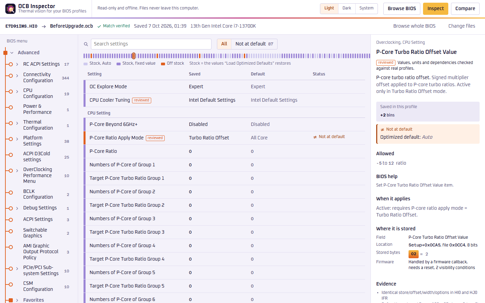
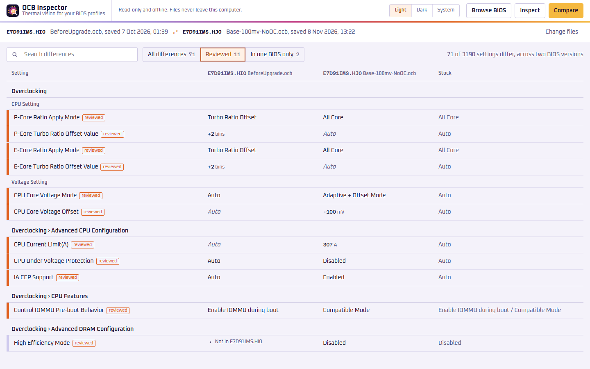
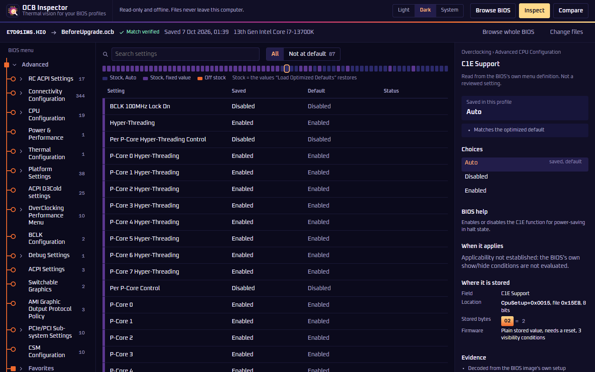
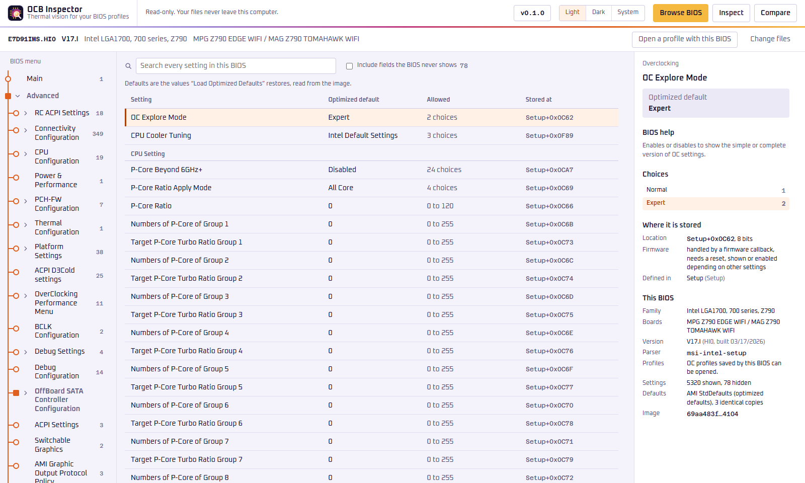

<p align="center">
  
</p>

<h1 align="center">OCB Inspector</h1>

<p align="center">
  Thermal vision for your BIOS profiles.<br>
  Open an MSI OC profile (<code>.ocb</code>) on your PC and see what's inside.
</p>

<p align="center">
  <a href="https://github.com/wapenshaw/ocb-inspector/releases/latest"></a>
  
  <a href="https://github.com/wapenshaw/ocb-inspector/actions/workflows/ci.yml"></a>
  <a href="LICENSE"></a>
</p>

MSI boards let you save your BIOS settings to a USB stick as an `.ocb` profile. That works until
you update the BIOS. A profile saved on one BIOS version won't load on another, so after an
update your old profile is just a file you can't use. If you don't remember exactly what you
changed, you have to find it all again by hand, because MSI gives you no way to open the file on
your PC and see what's in it.

OCB Inspector is our attempt to change that. Open the old profile together with the BIOS file it
was saved on, and you see the settings it can map, laid out the way the BIOS menus lay them out,
with a stock value beside each one where the firmware supplies it. Mapped values that differ
from those defaults are highlighted. Compare supported profiles from before and after an
update to see which stored settings differ.

Inspect uses the supplied BIOS's definitions to read recognized profiles and compare saved
values with available firmware defaults. A few profile/BIOS pairs from Intel 400-, 600- and
700-series boards have been examined. AMD BIOS images have been browsed, but no AMD profiles
have been tested.
See [Help wanted](#help-wanted-profiles-from-other-boards) to contribute another pair.

<p align="center">
  
</p>

<p align="center">
  
  
</p>

<p align="center">
  
</p>

## What it does

- **Browse a BIOS.** Open an MSI BIOS image and walk its setup menus as the BIOS shows them,
  with each setting's "Load Optimized Defaults" value. Intel 300–800 series, X299, AM4, AM5 and
  TRX40 images open.
- **Inspect a profile.** Open an `.ocb` profile with the BIOS that saved it and see the settings
  it can map (over 3,000 on examined Z790 pairs), what the BIOS menus call them, and whether
  they differ from available optimized defaults.
- **Compare two profiles.** Side by side, even across BIOS versions: settings are matched by
  their place in the menus, so a profile saved before a BIOS update lines up with one saved
  after it.
- **BIOS-derived Inspect (experimental).** Inspect maps profile records through the supplied
  BIOS's variable list and setup definitions. It labels inferred mappings and reports partial
  or blocked results. Compatible reviewed recipes can add units, signed values and Auto
  interpretations; generic fields keep raw values and the BIOS's labels. Those recipes were
  checked on one Z790 board and are also applied when compatible on other boards;
  this does not establish that their meanings were checked on those boards. Raw values,
  mapping evidence and raw comparisons remain available. Compare and experimental writing
  use the separate reviewed reader; Inspect enrichment does not widen writing support.
- **Defaults from your firmware.** Saved values are compared with the supplied BIOS's optimized
  defaults where available. Missing or conflicting defaults remain explicitly unknown; they
  are never treated as zero or unchanged. Generic numeric values can be raw storage numbers:
  sign and units may be encoded in separate settings or vendor logic, so a number alone does
  not establish a voltage, frequency or signed offset.
- **Compare with your own baseline.** The BIOS image's optimized defaults flag dozens of values
  the firmware fills in by itself (DMI lanes, fan types). To see only what differs from a clean
  setup, load optimized defaults in the BIOS, save a profile, and give it to the analysis as the
  baseline (`--baseline <file>`, or "Baseline profile" in the app). Best is a defaults profile
  saved on the same BIOS version as the profile you are reading. After a BIOS update you can no
  longer save on the old version: a profile saved on the new version right after the update (when
  the BIOS is at its defaults) also works. Give its BIOS image too (`--baseline-bios <image>`);
  settings are then matched by menu place and name, and a difference can also be a default that
  changed between the two versions. Settings present in only one version are not compared. A
  difference means the two files store different values, not which one you set.
- **Read-only, and your files stay on your computer.** Nothing is written and nothing is
  uploaded. Editing a profile and porting it to a new BIOS version exist, but are experimental
  and off by default (see [Read-only by default](#read-only-by-default)).
- **Tells you about new versions.** The version button in the header opens the changelog. At
  start the desktop app asks GitHub for the list of releases, which is the only thing it ever
  sends over the network; it downloads nothing itself. Turn that off under Settings on the same
  page, or with `"update_check": false` in `config/settings.json`.

`ocb-inspector` is the desktop app and `ocbi` the command-line tool (JSON output for scripts).
Both use the same Rust core.

## Download

Get the zip for your system from the [latest release](https://github.com/wapenshaw/ocb-inspector/releases/latest),
unzip it anywhere you can write to, and run `ocb-inspector`. There is no installer.

| System | File | Needs |
| --- | --- | --- |
| Windows 10 and 11 (x64) | `ocb-inspector-<version>-windows-x64.zip` | the WebView2 runtime, which Windows 11 includes and Windows 10 gets through Windows Update |
| Linux (x64) | `ocb-inspector-<version>-linux-x64.zip` | the desktop app: glibc 2.35+ and WebKitGTK 4.1 (below); `ocbi` runs on any x64 Linux |

Each release lists the zips' SHA-256 sums in `SHA256SUMS`, and every zip carries signed build
provenance: `gh attestation verify <zip> --repo wapenshaw/ocb-inspector` checks that it was built
by this repository's release workflow.

The Windows programs are not code-signed (the project has no Authenticode certificate), so
Windows SmartScreen may show "Windows protected your PC" the first time you run `ocb-inspector.exe`
or `ocbi.exe`. Choose "More info", then "Run anyway". The SHA-256 sums and the build provenance
check above are how to confirm that the download is the one this repository built.

### Linux

`ocbi` is a static binary with no dependencies. The desktop app draws its window with the
system's WebKitGTK, so it needs these packages (most desktops already have them):

| Distribution | Install |
| --- | --- |
| Ubuntu 22.04+, Debian 12+, Mint 21+ | `sudo apt install libwebkit2gtk-4.1-0 libgtk-3-0` |
| Fedora 37+ | `sudo dnf install webkit2gtk4.1 gtk3` |
| Arch, Manjaro | `sudo pacman -S webkit2gtk-4.1 gtk3` |
| openSUSE Tumbleweed | `sudo zypper install libwebkit2gtk-4_1-0 gtk3` |

Older distributions (Ubuntu 20.04, Debian 11, RHEL 8) have an older glibc or no WebKitGTK 4.1 and
cannot run the desktop app; `ocbi` still works there.

## Portable use

There is no installer. Keep the programs together in one folder, with everything else in a
`config` folder beside them:

| File | Purpose |
| --- | --- |
| `ocbi`, `ocb-inspector` (`.exe` on Windows) | the programs |
| `THIRD-PARTY-NOTICES.txt` | licences of the third-party code inside the programs; required when you give the programs to anyone |
| `config/approved-images.toml` | optional: the BIOS images that may be written to (the repository's `config/approved-images.toml`) |
| `config/settings.json` | optional: the experimental writing switch (below) and `"update_check": false`; the desktop app also keeps your colour mode here |
| `config/webview-data/` | created by the desktop app: its web view's data (WebView2 on Windows, WebKitGTK on Linux) |

The desktop app writes only inside `config`, never to `%APPDATA%`, `%LOCALAPPDATA%` or `~/.local`,
so the folder must be writable. Deleting `config/settings.json` and `config/webview-data/` resets it.

## Read-only by default

Out of the box both programs only read. You can open a BIOS on its own, open a profile with the BIOS
that saved it and see mapped settings (their saved values, available "Load Optimized Defaults"
values and whether they differ), and compare profiles supported by the reviewed reader, even
from different BIOS versions. Nothing is ever written.

Editing a profile and porting it to another BIOS version are **experimental**. They stay hidden, and
the CLI refuses `profile build` and `migrate build`, unless `config/settings.json` contains the
following (the desktop app's "Experimental writing" switch, under Settings on the version page,
writes it for you):

```json
{ "experimental": { "writing": true } }
```

Restart the app after changing it. Even then only the reviewed settings can be written, and only for
images listed in `approved-images.toml` (below). The CLI also takes `--settings <path>`.

Without `approved-images.toml` everything still opens, but every image is inspect-only: profiles can
be read and compared, not edited or migrated. The file is looked for, in order:

1. `ocbi --approvals <path>` (CLI only);
2. the path in the `OCB_APPROVALS` environment variable;
3. `config/approved-images.toml` beside the running executable.

An entry approves one exact image (BIOS ID plus SHA-256) and only takes effect on boards whose
settings recipes were reviewed (currently MSI 7D91). One bad entry rejects the whole file. Outputs
record the path and digest of the file that was used.

The release zips include `config/approved-images.toml`. For development builds, copy it to
`target/debug/config/` (and `target/release/config/`), and add a `settings.json` there with the
writing switch to test writing; `cargo clean` removes both. The build does not copy them on
purpose, so that a build is inspect-only unless someone puts the files there.

## What to know before loading a migrated profile

- **A verified file is not a tested file.** Migration writes a new `.ocb` profile for the new BIOS;
  the BIOS itself is never touched. Verification confirms the checksum, the structure and that the
  intended settings are present. It cannot tell whether the BIOS will accept the file or how it
  treats each setting. Treat the first load as a test: note your current settings, load the profile,
  and check each value in the BIOS screens. No import has been tried on hardware yet.
- **Loading a profile also restores CMOS.** In the MS-7D91 firmware examined, the 256 bytes after
  the settings are a copy of the board's CMOS memory at save time, and the BIOS's load code writes
  CMOS bytes 0x40 to 0xFF back from the file (the clock area is skipped). Migration keeps that
  block from the profile saved on the new BIOS, unchanged.
- **Only 21 reviewed settings are carried over.** They cover CPU P-/E-core ratio offsets, core
  voltage mode and offset, VR voltage limit, under-voltage protection, Enhanced Turbo, cooler
  tuning, PL1/PL2, current limit, CEP, Lite Load, LLC, AC/DC loadline, IOMMU and High Efficiency
  Mode (`ocbi capabilities` lists them). Everything else, such as memory and fan settings, comes
  from the profile saved on the new BIOS, not from the old one.
- **"Differs from optimized defaults" is a best reading.** The defaults come from the AMI
  `StdDefaults` store in the BIOS image, which is where F6 normally loads from. That has not been
  confirmed on hardware: load optimized defaults, save a profile, and check that the app marks
  almost nothing before relying on the highlighting. When the image's default copies disagree, no
  defaults are shown.
- **Coverage depends on the supplied pair.** Inspect can read recognized containers and stores
  it can map through that BIOS's definitions. Profile evidence currently covers the Intel pairs
  listed above; the AMD image corpus establishes browsing coverage only. Unknown layouts,
  ambiguous mappings and mismatched BIOS identities can limit or block interpretation.
  Read-only analysis does not grant Compare, editing or migration support.

For BIOS images containing several firmware sets, Inspect offers an inline firmware-set selector.
The CLI accepts `--set <number>` (1-based). Choosing a set is a hypothesis about where the
profile came from, not proof that the set saved it.

## CLI exit codes

Strict commands such as `profile inspect` distinguish malformed input or a BIOS/profile
identity mismatch (exit **4**) from an unsupported or ambiguous layout (exit **5**).
In particular, a valid matching-identity profile with no record of the required store size
returns `unsupported` / 5. This corrects the older `identity_mismatch` / 4 classification:
an unbindable store does not establish that the BIOS identity is wrong.

| Code | Meaning |
| --- | --- |
| 0 | Requested operation completed |
| 1 | Internal failure |
| 2 | Usage or request schema error |
| 3 | I/O, output collision or resource limit |
| 4 | Malformed binary or BIOS/profile identity mismatch |
| 5 | Unsupported or ambiguous layout, codec, condition or integrity rules |
| 6 | Setting validation or patch precondition failure |
| 7 | Unresolved migration conflicts |
| 8 | Generated-output verification failure |
| 9 | Input hash, schema or adapter binding changed |

`profile analyze` returns 0 when analysis completes, including reports with unrecognized,
mismatched or blocked inputs; consult the report's status and diagnostics. I/O, resource limits
and invalid arguments still use the error codes above. JSON errors from strict commands contain
`kind: "ocb.error"`, `code`, `exit_code` and `message`.

## Building from source

You need Rust (rustup installs the pinned toolchain from `rust-toolchain.toml`), Node.js 26 and
pnpm, and on Linux the [Tauri system packages](https://tauri.app/start/prerequisites/#linux).

```sh
cd ui && pnpm install && pnpm build && cd ..
cargo build --release -p ocbi-cli            # target/release/ocbi
cargo build --release -p ocbi-desktop        # target/release/ocb-inspector
cargo test --workspace
```

`cd ui && pnpm dev` runs the UI alone in a browser. See [CONTRIBUTING.md](CONTRIBUTING.md) before
opening a pull request.

## Help wanted: profiles from other boards

Inspect uses the same experimental BIOS-derived reading for all recognized, mappable pairs
(`ocbi profile analyze --profile <file> --bios <image>`, or choose the pair in Inspect).
Its JSON report says which parts were inferred and which could not be read. If you have a
profile from another board or firmware release,
[share it in a profile report](https://github.com/wapenshaw/ocb-inspector/issues/new?template=profile_report.yml),
ideally with that analysis saved as a shareable report (`--shareable`, or "Save shareable report"
in the app), which leaves out the CPU name, the save time and raw record bytes. Two profiles that differ in one setting you changed on purpose are the
most useful.

## Licences

This project is MIT-licensed (`LICENSE`). It ships with third-party code under other licences:

- Third-party code compiled into the programs (Rust crates, the bundled UI's JavaScript packages,
  and the EDK2 reference for the EFI/Tiano decompressor) is listed with full licence texts in
  `THIRD-PARTY-NOTICES.txt`. Regenerate it after changing dependencies:
  `python -I tools/third_party_notices.py` (`--check` reports whether it is up to date).
- `crates/core/src/firmware/LICENSE-EDK2.txt` stays next to `tiano.rs`, whose decompressor was
  written with EDK2's BSD-2-Clause-Patent code as a reference.
- During research, a local extractor built from the GPL-3.0 `Asofwar/ocb-studio-native` produced
  BIOS field tables. That tool is not in this repository and must not be distributed with the
  programs.
